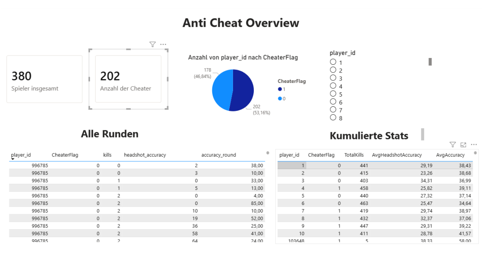
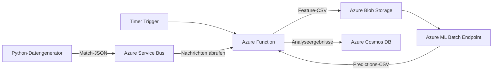

# Azure Anti-Cheat Batch Pipeline

Dieses Projekt demonstriert eine cloudbasierte Verarbeitungspipeline zur
Erkennung auffälliger Verhaltensmuster in Multiplayer-Shootern. Simulierte
Rundenstatistiken werden über Azure Service Bus entkoppelt übertragen, in
regelmäßigen Batches verarbeitet, mit einem Azure-Machine-Learning-Modell
klassifiziert und anschließend in Azure Cosmos DB gespeichert.

Der enthaltene Stand konzentriert sich auf den technischen Kern der Pipeline.
Cloud-spezifische Namen und Zugangsdaten werden ausschließlich über
Umgebungsvariablen beziehungsweise Azure App Settings konfiguriert.

## Angestrebtes Endergebnis

Das Endergebnis der Pipeline soll ein übersichtliches Power-BI-Dashboard sein.
Es stellt die Gesamtzahl der analysierten Spieler und der erkannten Cheater dar,
zeigt deren Verteilung und ermöglicht die gezielte Auswahl einzelner Spieler.
Zusätzlich werden alle Rundenwerte sowie kumulierte Statistiken wie Kills,
Headshot-Genauigkeit und allgemeine Treffergenauigkeit gegenübergestellt.



## Funktionsumfang

- Erzeugung realistischer Match-, Runden- und Spielerstatistiken
- kontrollierter Versand der Matchdaten an Azure Service Bus
- zeitgesteuerte Batchverarbeitung mit Azure Functions
- Zwischenspeicherung der ML-Eingabedaten in Azure Blob Storage
- Einrichtung und Test des Azure ML Batch Endpoints über ein Notebook
- Aufruf des Azure ML Batch Endpoints durch die Function App
- Zusammenführung der Vorhersagen mit den Spieler-IDs
- Speicherung der Analyseergebnisse in Azure Cosmos DB

## Ablauf



Die Function läuft standardmäßig alle zwei Minuten. Pro Abruf verarbeitet sie
bis zu 200 Service-Bus-Nachrichten und wiederholt den Abruf, bis die Queue für
fünf Sekunden keine weiteren Nachrichten liefert. Jede Nachricht enthält die
Rundendaten eines vollständigen Matches.

## Technischer Aufbau

| Bereich | Technologie | Aufgabe |
| --- | --- | --- |
| Datensimulation | Python | Match- und Spielerstatistiken erzeugen |
| Messaging | Azure Service Bus | Produktion und Verarbeitung entkoppeln |
| Batchsteuerung | Azure Functions, Timer Trigger | Queue leeren und Verarbeitung koordinieren |
| Zwischenspeicher | Azure Blob Storage | Feature-Dateien für die ML-Inferenz bereitstellen |
| Klassifikation | Azure Machine Learning Batch Endpoint | auffällige Datensätze klassifizieren |
| Ergebnisspeicher | Azure Cosmos DB | Vorhersagen und zugehörige Metriken persistieren |

## Beispielhafter Datenfluss

```text
Match mit mehreren Runden
        ↓
JSON-Nachricht im Service Bus
        ↓
15 numerische Merkmale pro Spieler und Runde
        ↓
CSV-Datei im Blob Storage
        ↓
Batch-Inferenz: prediction = 0 oder 1
        ↓
Dokument mit Spieler-ID, Merkmalen und Vorhersage in Cosmos DB
```

## Schnellstart

1. Eine Python-Umgebung erstellen und die Abhängigkeiten installieren.
2. Die benötigten Azure-Ressourcen bereitstellen.
3. Service-Namen und Verbindungsdaten als Umgebungsvariablen konfigurieren.
4. Die Function lokal oder in Azure starten.
5. Testdaten mit dem Generator an die Queue senden.

```powershell
python -m venv .venv
.\.venv\Scripts\Activate.ps1
pip install -r requirements.txt
$env:SERVICEBUS_CONNECTION_STRING = "<connection-string>"
python generator.py --queue-name "<queue-name>" --duration 60
```

Die vollständige Konfiguration ist in [docs/SETUP.md](docs/SETUP.md)
beschrieben.

## Projektstruktur

```text
.
├── generator.py                 # Erzeugung und Versand simulierter Matchdaten
├── requirements.txt             # Abhängigkeit des Datengenerators
├── functionapp/
│   ├── function_app.py          # Timer-gesteuerte Verarbeitungspipeline
│   ├── host.json                # Azure-Functions-Konfiguration
│   └── requirements.txt         # Abhängigkeiten der Function App
├── ml/
│   ├── Notebook_endpoint.ipynb  # Einrichtung und Test des Batch Endpoints
│   └── batch_driver.py          # Scoring-Skript des ML Batch Endpoints
└── docs/
    ├── anti-cheat-dashboard.png # Beispiel des angestrebten Power-BI-Dashboards
    ├── ARCHITEKTUR.md           # Komponenten, Datenfluss und Entscheidungen
    ├── DATENMODELL.md           # Telemetrie- und Ergebnisstruktur
    └── SETUP.md                 # Lokale und Azure-Konfiguration
```

## Dokumentation

- [Architektur und Verarbeitung](docs/ARCHITEKTUR.md)
- [Datenmodell](docs/DATENMODELL.md)
- [Installation und Konfiguration](docs/SETUP.md)
- [Azure-ML-Endpoint-Notebook](ml/Notebook_endpoint.ipynb)

