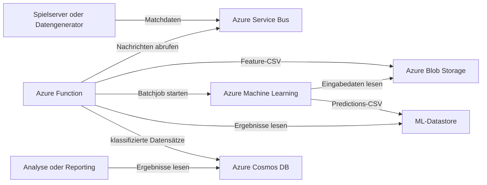
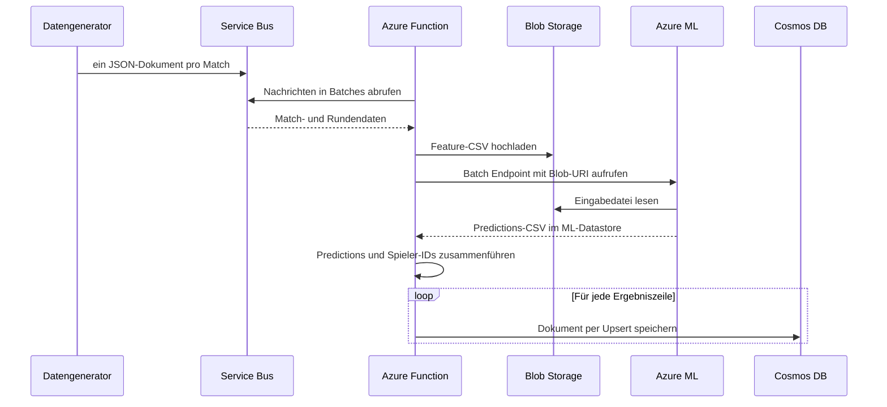

# Architektur

## 1. Ziel und Systemgrenze

Die Pipeline analysiert aggregierte Spielerstatistiken aus Multiplayer-Matches
und ergänzt jeden Datensatz um eine Klassifikation des ML-Modells. Sie arbeitet
zeitgesteuert und ist damit für kontrollierte Batchverarbeitung statt für eine
unmittelbare Reaktion während eines Matches ausgelegt.

Der enthaltene Systemausschnitt beginnt bei der Simulation der Matchdaten und
endet mit der Speicherung der Klassifikation in Cosmos DB. Spieleclient,
Trainingsprozess des Modells, Sanktionierung von Accounts und Auswertung in
einem Dashboard liegen außerhalb dieser Grenze.

## 2. Systemkontext

## 3. Komponenten

### 3.1 Datengenerator

`generator.py` erzeugt mehrere Matches mit einer zufälligen Rundenzahl. Jedem
Match werden Spieler-IDs zugeordnet, deren kumulierte Werte sich über die
Runden hinweg entwickeln. Neben Kills, Toden, Assists und Schaden entstehen
Präzisions- und Headshot-Metriken.

Der Generator schreibt die Daten zunächst in eine CSV-Datei, gruppiert sie
anschließend nach Match-ID und sendet jedes Match als eine JSON-Nachricht an
Azure Service Bus. Versandrate und Testdauer sind konfigurierbar.

### 3.2 Azure Service Bus

Die Queue entkoppelt Datenproduktion und Analyse. Der Generator muss weder die
Azure Function noch das ML-Modell direkt kennen. Temporäre Lastspitzen können
als persistierte Nachrichten gepuffert und später als Batch abgerufen werden.

### 3.3 Azure Function

Die Function `timer_trigger_final` wird über einen Timer Trigger mit dem
Ausdruck `10 */2 * * * *` gestartet, also alle zwei Minuten bei Sekunde 10.

Pro Schleifendurchlauf fordert sie maximal 200 Nachrichten an. Der
`prefetch_count` von 500 reduziert zusätzliche Netzwerkabrufe. Bleiben fünf
Sekunden lang weitere Nachrichten aus, beginnt die Datenaufbereitung.

### 3.4 Blob Storage

Die Function extrahiert aus den Matchnachrichten die 15 numerischen
Modellmerkmale und schreibt sie als CSV-Datei in einen Blob-Container. Ein
Zeitstempel und eine UUID erzeugen für jeden Durchlauf einen eindeutigen
Dateinamen.

Blob Storage entkoppelt die Function vom ML-Compute: Der Batch Endpoint erhält
nur den URI der Eingabedatei und kann sie unabhängig von der Function laden.

### 3.5 Azure ML Batch Endpoint

Die Function ruft den konfigurierten Batch Endpoint mit der Feature-Datei auf
und wartet auf den Abschluss des Jobs. `ml/batch_driver.py` lädt beim Start das
versionierte Modell und führt für jede CSV-Datei `model.predict()` aus.

Das Notebook [`ml/Notebook_endpoint.ipynb`](../ml/Notebook_endpoint.ipynb)
dokumentiert die technische Bereitstellung dieser Komponente. Es verbindet sich
mit dem Azure ML Workspace, registriert das Modell, richtet den Compute-Cluster
und den Batch Endpoint ein, erstellt das Deployment und führt einen Testlauf
mit Beispieldaten aus.

Die Ergebnisse werden als `predictions.csv` in den konfigurierten ML-Datastore
geschrieben. Danach lädt die Function diese Datei, übernimmt die letzte Spalte
als Klassifikation und ordnet die Werte wieder den Spieler-IDs zu.

### 3.6 Cosmos DB

Jede klassifizierte Zeile wird als separates Cosmos-DB-Dokument gespeichert.
Das Dokument enthält die Modellmerkmale, die Spieler-ID, die Vorhersage und
eine neu erzeugte UUID als technische Dokument-ID.

## 4. Verarbeitungsablauf

## 5. Entwurfsentscheidungen

### 5.1 Zeitgesteuerte Batchverarbeitung

Der Timer sorgt für planbare Verarbeitungsläufe und bündelt mehrere Matches zu
einem ML-Auftrag. Das reduziert die Anzahl einzelner Modellaufrufe, führt aber
zu einer gewollten Erkennungslatenz.

### 5.2 Entkopplung über Queue und Blob Storage

Service Bus puffert eingehende Matches, während Blob Storage die
dateibasierte Übergabe an Azure ML übernimmt. Beide Übergänge verhindern eine
direkte Laufzeitkopplung zwischen Datenerzeugung, Function und ML-Compute.

### 5.3 Getrennte Betriebsdaten und Analyseergebnisse

Die Queue dient nur als Transport, Blob Storage als temporäre
Verarbeitungsebene und Cosmos DB als langfristig abfragbarer Ergebnisspeicher.
Damit sind die Verantwortlichkeiten der Speicherdienste klar getrennt.

## 6. Fehlerverhalten und bekannte Grenzen

- Nachrichten werden nach erfolgreicher Deserialisierung bestätigt. Tritt ein
  späterer Fehler in Blob Storage, Azure ML oder Cosmos DB auf, befinden sie
  sich nicht mehr in der Queue.
- Die Function wartet synchron auf den Abschluss des ML-Jobs. Lange Jobs
  verlängern entsprechend die Function-Laufzeit.
- Das Ausgabeziel des ML-Jobs wird vor einem neuen Lauf bereinigt. Parallele
  Function-Ausführungen benötigen daher getrennte Ausgabepfade.
- Die Reihenfolge der Predictions wird aktuell als identisch zur Reihenfolge
  der Eingabezeilen angenommen.
- Einzelne Cosmos-Dokumente werden nacheinander geschrieben; für große Batches
  wäre eine parallele oder bulk-basierte Speicherung geeigneter.

Für einen robusteren Betrieb sollten Nachrichten erst nach abgeschlossener
Persistenz bestätigt, fehlgeschlagene Nachrichten in eine Dead-Letter-Queue
verschoben und jedem Eingabedatensatz eine durchgängige Korrelations-ID
mitgegeben werden.
